### Resumo
O hit evaluator para `PS8A6DD1D52752FAD6` reutiliza a álgebra integral do shader original (luzes diretas, AO, emissivos, overbright e gamma) substituindo o modelo de rasterização por amostragem desacoplada com atributos interpolados do hit e view voltada à origem do raio secundário. Em vez de ler `b1`/`b2` estáticos ou invocar `Sample` com derivadas implícitas de quad, o evaluator consome snapshots por material em heaps bindless e `SampleLevel` com LOD explícito derivado de footprint/cone. O ponto de inserção no receptor ocorre estritamente após o único `tfetchCube` (linha 1944), preservando a composição original do ambiente, enquanto hits opacos não suportados retornam `confidence = 0` para atuar como oclusores sem vazamento de fundo.

---

### Plano Implementável em 5 Partes

```mermaid
flowchart TD
    subgraph Part1["Parte 1: Captura de Atributos e Snapshot de Material"]
        A[PostVertexCapture / Stream Output] -->|TC0, TC1, TC2, TC3, TC5, TC6| B[HitVertexArena Buffer]
        C[UploadConstants / native_renderer] -->|cbuffer PS + SharedIndices + Bools| D[HitMaterialSnapshotBuffer]
    end

    subgraph Part2["Parte 2: Transformação da Função de Shading"]
        E[Transformar PS original em Evaluator] --> F["Substituir Sample por SampleLevel (LOD explícito)"]
        E --> G["V = normalize(rayOrigin - Ph)"]
        E --> H["Fallback cubemap local sem recursão RT"]
    end

    subgraph Part3["Parte 3: Traçador e Resolução de Interseção"]
        I[Trace Ray secundário na TLAS] --> J{Hit Opaque?}
        J -- Não / Miss --> K["confidence = 0 (Fallback receptor)"]
        J -- Sim, material não suportado --> L["confidence = 0 (Blocker oclusor)"]
        J -- Sim, PS 8A6D suportado --> M[Barycentric Interp + Evaluator]
        M --> N["confidence = 1.0, radianceRGB lit"]
    end

    subgraph Part4["Parte 4: Ponto de Inserção Cirúrgico no Receptor"]
        O["Receiver PS 8A6D: salvar R antes de cube()"] --> P["Executar tfetchCube original (linha 1944)"]
        P --> Q["r12.yzw = lerp(Eoriginal, litHit.radianceRGB, litHit.confidence)"]
        Q --> R["Preserva dot(W, Kenv), gEnvMapTint, dirt e overbright"]
    end

    subgraph Part5["Parte 5: Pipeline e Fingerprint de Cache"]
        S[shader_translator.cpp / RtReflectionShaderCacheIdentity] --> T[Cache DXIL independente]
    end
```



---

#### Parte 1: Captura de Atributos do Hit e Registro de Snapshots de Material
1. **Atributos de Vértice Expandidos (Post-VS)**:
   - Atualmente, [post_vertex_capture.h](file:///C:/Users/Gusta/Documents/outros-projetos/superman_returns_recomp/port/src/graphics/d3d12/post_vertex_capture.h#L15-L20) e [post_vertex_capture.cpp](file:///C:/Users/Gusta/Documents/outros-projetos/superman_returns_recomp/port/src/graphics/d3d12/post_vertex_capture.cpp#L75) gravam apenas `float3` (12 bytes por vértice) via Geometry Shader stream-out.
   - Para alimentar o hit evaluator, o GS de captura para malhas visíveis de reflexão deve emitir o layout `HitVertex`:
     - `Position`: world $P$ (vindo de `iTexCoord2.xyz`, 12B)
     - `Normal`: base normal $N_g$ (vindo de `iTexCoord0.xyz`, 12B)
     - `Tangent`: vetor tangente $T$ (vindo de `iTexCoord1.xyz`, 12B)
     - `UV`: UV0 e UV1 (vindos de `iTexCoord3.xy` e `iTexCoord3.zw`, 16B)
     - `Light`: varying $L$ da luz do draw (vindo de `iTexCoord5.xyz`, 12B)
     - `ShadowCoord`: coordenadas do atlas (vindas de `iTexCoord6.xyzw`, 16B)
     - Total: 80 bytes por vértice (ou alinhado a 96 bytes).
2. **Snapshot de Material por Draw (`HitMaterialSnapshot`)**:
   - Em [native_renderer.cpp](file:///C:/Users/Gusta/Documents/outros-projetos/superman_returns_recomp/port/src/native_renderer/native_renderer.cpp#L4380-L4550) (`UploadConstants`), registrar os dados de cada draw elegível para reflexão em um buffer estruturado host-upload/GPU `g_HitMaterials`:
     - 256 constantes `float4` de Pixel Shader (4096 bytes).
     - Índices de SRV e Sampler (slots 0 a 15) montados em `s[0..63]` (linhas 4546–4549).
     - Xenos Booleans `s[64..71]` (linhas 4553–4558) e Runtime SpecConstants `s[72]` (linha 4403).
   - O draw mapeia seu intervalo de triângulos na TLAS para seu `material_index` correspondente via buffer de indexação de primitivas (`primitive_to_material_id`).

---

#### Parte 2: Evaluator de Shading e Política de Footprint / LOD
1. **Incompatibilidade das Funções `Sample` em Shaders de Hit**:
   - Em [8A6DD1D52752FAD6.ps.hlsl](file:///C:/Users/Gusta/Documents/outros-projetos/superman_returns_recomp/artifacts/shaders/hlsl/8A6DD1D52752FAD6.ps.hlsl#L256), [tfetch2D](file:///C:/Users/Gusta/Documents/outros-projetos/superman_returns_recomp/artifacts/shaders/hlsl/8A6DD1D52752FAD6.ps.hlsl#L246-L257), [tfetch3D](file:///C:/Users/Gusta/Documents/outros-projetos/superman_returns_recomp/artifacts/shaders/hlsl/8A6DD1D52752FAD6.ps.hlsl#L357-L360) e [tfetchCube](file:///C:/Users/Gusta/Documents/outros-projetos/superman_returns_recomp/artifacts/shaders/hlsl/8A6DD1D52752FAD6.ps.hlsl#L375-L378) invocam `texture.Sample(sampler, uv)`.
   - **Causa impeditiva**: Operações de amostragem implícita requerem derivadas de hardware de quads 2×2 (`ddx`/`ddy`). Em traçado de raio (tanto DXR RTPSO quanto `RayQuery` inline):
     - Lançamentos divergentes em pixels adjacentes colidem com instâncias, primitivas ou distâncias distintas (ou dão miss), tornando o cálculo de derivadas em quad indefinido e gerando degradação catastrófica de mipmap e ruído.
     - Em perfil SM 6.3/6.5 Raytracing (`[shader("callable")]`), o compilador DXC rejeita sumariamente `Sample` implícito com erro de compilação.
   - **Transformação**: Substituir todas as macros de amostragem no evaluator por `.SampleLevel(sampler, uv, hitLOD)` (ou `.SampleGrad` caso derivadas de triângulo estejam disponíveis).
2. **Transformações Algébricas Mínimas no Evaluator**:
   - **Vetor de Visão ($V$)**: No VS original ([2C45BFFE76D77398.vs.hlsl:993–999](file:///C:/Users/Gusta/Documents/outros-projetos/superman_returns_recomp/artifacts/shaders/hlsl/2C45BFFE76D77398.vs.hlsl#L993-L999)), $V = C - P$ aponta para a câmera primária. No hit secundário em $P_h$, a visão incidente provém da origem do raio refletido ($P_{receiver}$):
     $$\vec{V}_{hit} = \text{normalize}(P_{receiver} - P_h)$$
     Substituir a inicialização de `r11.xyz` ([8A6DD1D52752FAD6.ps.hlsl:1036](file:///C:/Users/Gusta/Documents/outros-projetos/superman_returns_recomp/artifacts/shaders/hlsl/8A6DD1D52752FAD6.ps.hlsl#L1036)) por $\vec{V}_{hit}$.
   - **Vetor de Normal e Tangente**: Inicializar a partir dos atributos interpolados via coordenadas baricêntricas $(b_0, b_1, b_2)$:
     $$\text{Attr}_{hit} = b_0 \cdot \text{Attr}_0 + b_1 \cdot \text{Attr}_1 + b_2 \cdot \text{Attr}_2$$
     Normalizar $N_g$ (`iTexCoord0`) e $T$ (`iTexCoord1`), preservando a reconstrução exata da normal perturbada por normal map e noise 3D (linhas 1118–1229).
   - **Luz Direta e Sombra**: Preservar a avaliação com `iTexCoord5` e atlas constants originais.
   - **Ambiente no Hit (1-Bounce sem Recursão RT)**:
     - Na linha 1944 do hit secundário, executar o `tfetchCube` local do material da superfície atingida utilizando sua própria direção refletida $R_{hit}$ em `r6.xyz`.
     - Isso fornece a contribuição de reflexão ambiente da superfície secundária sem disparar raios RT adicionais.
   - **Gama e Overbright**: Preservar [conanPwlGammaToLinear](file:///C:/Users/Gusta/Documents/outros-projetos/superman_returns_recomp/artifacts/shaders/hlsl/8A6DD1D52752FAD6.ps.hlsl#L186-L197), tons de sujeira (`r9.x`, linhas 1323–1365) e composição `gOverBright` ([8A6DD1D52752FAD6.ps.hlsl:697](file:///C:/Users/Gusta/Documents/outros-projetos/superman_returns_recomp/artifacts/shaders/hlsl/8A6DD1D52752FAD6.ps.hlsl#L697)).

---

#### Parte 3: Política Concreta de Footprint / LOD
1. **Modelo de Cone de Raio (Ray Cone)**:
   - O raio secundário é lançado com abertura angular $\beta$ herdada do pixel do receptor:
     $$\beta = \frac{2 \tan(\text{FOV} / 2)}{\text{Resolução Vertical}}$$
   - Abertura de raio acumulada na distância $t$:
     $$r_{footprint}(t) = r_{origin} + t \cdot \beta$$
   - Projeção no plano do triângulo atingido com normal $N_h$ e direção incidente $\vec{R}$:
     $$\text{Área do Footprint} \propto \frac{r_{footprint}(t)}{\max(|N_h \cdot (-\vec{R})|, 0.05)}$$
2. **Cálculo do Mip Level**:
   - $\lambda = \text{clamp}\left(0.5 \cdot \log_2(\text{FootprintTexels}^2), 0.0, \text{MaxMipLevel}\right)$.
   - Se os gradientes de UV do triângulo ($\frac{\partial UV}{\partial P}$) não estiverem no buffer de vértices, utilizar formulação isotrópica parametrizada pela dimensão do guest descriptor ([getGuestTexture2DDimensions](file:///C:/Users/Gusta/Documents/outros-projetos/superman_returns_recomp/artifacts/shaders/hlsl/8A6DD1D52752FAD6.ps.hlsl#L239-L242)).

---

#### Parte 4: Ponto de Inserção Exato no Receptor e Substituição do SampleEnv
1. **Recuperação de Direção de Reflexão**:
   - Em [8A6DD1D52752FAD6.ps.hlsl:1904–1925](file:///C:/Users/Gusta/Documents/outros-projetos/superman_returns_recomp/artifacts/shaders/hlsl/8A6DD1D52752FAD6.ps.hlsl#L1904-L1925), `r4.xyz` contém exatamente o vetor refletido no espaço de mundo ($R$).
   - Na linha 1929 (`r4.xyzw = cube(r4.xyzz, cubeMapData);`), a função helper converte $R$ em um índice interno e zera as componentes cartesianas.
   - **Âncora 1 (Pré-Cube)**: Salvar `float3 worldR = r4.xyz;` imediatamente antes da linha 1929.
2. **Substituição do Sample de Ambiente**:
   - Em [8A6DD1D52752FAD6.ps.hlsl:1944](file:///C:/Users/Gusta/Documents/outros-projetos/superman_returns_recomp/artifacts/shaders/hlsl/8A6DD1D52752FAD6.ps.hlsl#L1944):
     ```hlsl
     r12.yzw = tfetchCube(env_map_TextureCubeDescriptorIndex, env_map_SamplerDescriptorIndex, r6.xyz, cubeMapData).xyz;
     ```
   - **Âncora 2 (Pós-Cube)**: Inserir imediatamente após a linha 1944:
     ```hlsl
     float3 Eoriginal = r12.yzw;
     // Disparo / chamada do avaliador de hit secundário
     r12.yzw = lerp(Eoriginal, litHit.radianceRGB, litHit.confidence);
     ```
   - **Integridade da Composição**:
     - As linhas 1950 a 2032 ([8A6DD1D52752FAD6.ps.hlsl:1950-2032](file:///C:/Users/Gusta/Documents/outros-projetos/superman_returns_recomp/artifacts/shaders/hlsl/8A6DD1D52752FAD6.ps.hlsl#L1950-L2032)) multiplicam `r12.yzw` por `gEnvMapTint.rgb * gKSEsD.y * dot(W, Kenv) * d`.
     - Substituir estritamente `r12.yzw` garante que toda a ponderação de material, atenuação de sujeira, soma com specular direto (linha 2109) e overbright (linha 2121) permaneçam idênticos à arte original, sem duplicar luz ambiente e sem bypass de parâmetros.

---

#### Parte 5: Traçado de Raio, Oclusores sem Suporte e Identidade de Pipeline
1. **Regra de Traçado do Nearest Hit**:
   - A consulta de reflexão deve executar traçado de *Closest Hit* (`RAY_FLAG_NONE`, nunca `ACCEPT_FIRST_HIT_AND_END_SEARCH`).
2. **Nearest Unsupported Blocker / Confidence 0**:
   - Se o raio colidir com uma primitiva opaca cujo shader de material não seja `PS8A6D` (ou seja um caster deslocado / geometria sem snapshot):
     - A colisão **deve ser confirmada como o hit mais próximo** (não ignorar a geometria).
     - O avaliador retorna:
       $$\text{litHit.confidence} = 0.0f, \quad \text{litHit.radianceRGB} = \text{float3}(0, 0, 0)$$
     - **Efeito visual**: Pelo `lerp(Eoriginal, litHit.radianceRGB, 0.0)`, o receptor reproduz o cubemap local original. Isso impede o artefato crítico de *see-through* (onde objetos desconhecidos ficam transparentes, revelando superfícies refletidas atrás deles).
3. **Especialização e Fingerprint de Cache**:
   - Em [rt_shadow_shader.cpp](file:///C:/Users/Gusta/Documents/outros-projetos/superman_returns_recomp/port/src/graphics/rt_shadow_shader.cpp#L16-L85) e [shader_translator.cpp](file:///C:/Users/Gusta/Documents/outros-projetos/superman_returns_recomp/port/src/native_renderer/shader_translator.cpp#L149-L150), o sistema usa `RtShadowShaderCacheIdentity()`.
   - Implementar `RtReflectionShaderCacheIdentity()` contendo o texto da injeção e o hash auditado `0x8A6DD1D52752FAD6ull`, garantindo invalidação atômica do cache DXIL sem colidir com o patch de sombras.

---

### Contratos de Buffers, Constantes e Interfaces

#### 1. Layout do Vértice Capturado para Reflexão (`ReflectionHitVertex`)
Alinhamento: 16 bytes. Stride total: 80 bytes.

| Offset (bytes) | Campo HLSL / C++ | Tipo | Semântica de Origem |
| :--- | :--- | :--- | :--- |
| `0` | `float3 position` | `R32G32B32_FLOAT` | `iTexCoord2.xyz` ([2C45:1034](file:///C:/Users/Gusta/Documents/outros-projetos/superman_returns_recomp/artifacts/shaders/hlsl/2C45BFFE76D77398.vs.hlsl#L1034)) |
| `12` | `float3 normal` | `R32G32B32_FLOAT` | `iTexCoord0.xyz` ([2C45:1028](file:///C:/Users/Gusta/Documents/outros-projetos/superman_returns_recomp/artifacts/shaders/hlsl/2C45BFFE76D77398.vs.hlsl#L1028)) |
| `24` | `float3 tangent` | `R32G32B32_FLOAT` | `iTexCoord1.xyz` ([2C45:1020](file:///C:/Users/Gusta/Documents/outros-projetos/superman_returns_recomp/artifacts/shaders/hlsl/2C45BFFE76D77398.vs.hlsl#L1020)) |
| `36` | `float4 uv0_uv1` | `R32G32B32A32_FLOAT` | `iTexCoord3.xyzw` ([2C45:1039](file:///C:/Users/Gusta/Documents/outros-projetos/superman_returns_recomp/artifacts/shaders/hlsl/2C45BFFE76D77398.vs.hlsl#L1039)) |
| `52` | `float3 light` | `R32G32B32_FLOAT` | `iTexCoord5.xyz` ([2C45:1052](file:///C:/Users/Gusta/Documents/outros-projetos/superman_returns_recomp/artifacts/shaders/hlsl/2C45BFFE76D77398.vs.hlsl#L1052)) |
| `64` | `float4 shadow_coord` | `R32G32B32A32_FLOAT` | `iTexCoord6.xyzw` ([2C45:1060](file:///C:/Users/Gusta/Documents/outros-projetos/superman_returns_recomp/artifacts/shaders/hlsl/2C45BFFE76D77398.vs.hlsl#L1060)) |

#### 2. Layout do Snapshot de Material (`HitMaterialData`)
Buffer estruturado `StructuredBuffer<HitMaterialData> g_HitMaterials : register(t1, space7);`

```cpp
struct HitMaterialData {
  float ps_constants[256][4];  // 4096 bytes: espelho c0..c255 de g_PixelShaderConstantsArr
  uint32_t srv_indices[16];    // 64 bytes: slots 0..15 (bits 31 gamma, 16..27 scale)
  uint32_t sampler_indices[16];// 64 bytes: samplers associados aos slots
  uint32_t booleans[8];        // 32 bytes: Xenos bool register file
  uint32_t spec_constants;     // 4 bytes: runtime spec constants
  uint32_t padding[7];         // 28 bytes: alinhamento para múltiplo de 256 bytes
};
static_assert(sizeof(HitMaterialData) == 4288);
```

#### 3. Payload de Retorno do Evaluator (`LitHitPayload`)

```hlsl
struct LitHitPayload {
    float3 radianceRGB;   // Radiância de saída calculada pela equação de iluminação completa
    float confidence;     // 1.0 = hit suportado totalmente lit; 0.0 = miss ou blocker não suportado
    float hitDistance;    // Distância t da interseção
    uint primitiveIndex;  // ID da primitiva
};
```

#### 4. Constantes do Draw de Reflexão (`cbuffer SrRtReflectionDraw : register(b4, space4)`)

```cpp
struct SrRtReflectionDrawConstants {
  uint32_t enabled;
  float bias;
  float max_distance;
  float cone_angle;
  uint32_t max_bounces; // Inicialmente 1
  uint32_t mask;        // 1=World, 2=Character
  uint32_t padding[2];
};
static_assert(sizeof(SrRtReflectionDrawConstants) == 32);
```

---

### Lacunas Verificáveis e Limites do Escopo

1. **Ausência de Prova Numérica de LOD / Gradientes de Vértice**:
   - Os buffers de vértices raster do Superman Returns não incluem derivadas de textura pré-computadas ($\frac{\partial UV}{\partial x}$, $\frac{\partial UV}{\partial y}$).
   - Qualquer atribuição de LOD baseada puramente em distância ou abertura angular de cone é uma **aproximação heurística** que requer calibração visual empírica contra amostras com mipmapping nativo.
2. **Não Existência de PBR / Roughness Nativa**:
   - O material decompõe o brilho especular em uma função racional com base no blend de 4 pesos $W$ com `sS_exp` ([8A6D:1962](file:///C:/Users/Gusta/Documents/outros-projetos/superman_returns_recomp/artifacts/shaders/hlsl/8A6DD1D52752FAD6.ps.hlsl#L1962)): $\text{shape} = \frac{c}{n(1-c) + c}$.
   - Não existe parâmetro de rugosidade perceptual GGX ou metalness no código original. Inferir um valor de rugosidade a partir de `sS_exp` sem calibração fotométrica violaria o princípio de paridade estrita.
3. **Restrição de Geometria de Shadow Casters Deslocada**:
   - Os casters de sombra utilizam bias de deslocamento normal (`shadowMapCasterPass_Thickness_Bias.y`, [docs:230–245](file:///C:/Users/Gusta/Documents/outros-projetos/superman_returns_recomp/docs/rt-reflection-input-contract-2026-10-25.md#L230-L245)), deformando as malhas. Apenas vértices capturados de passes visíveis não deslocados podem ser submetidos à TLAS de reflexão.
4. **Completude de Residência Offscreen**:
   - O renderer descarta comandos de geometria que sofrem culling pelo frustum primário da CPU. Objetos refletidos fora da tela só estarão presentes na TLAS se a captura de submissões mantiver uma política de residência estendida, a qual não está implementada no snapshot atual de [native_renderer.cpp](file:///C:/Users/Gusta/Documents/outros-projetos/superman_returns_recomp/port/src/native_renderer/native_renderer.cpp#L6908-L6935).
