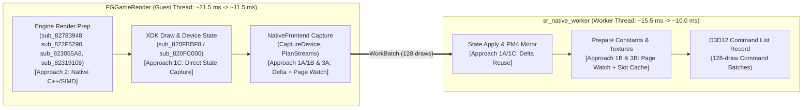

# Design Spec: D3D12 Native Renderer +60 FPS Optimization Roadmap (Approaches 1, 2, and 3)

- **Date:** 2026-11-04
- **Target:** Achieve sustained **>60 FPS (<16.67 ms/frame)** in the standard 60-second title flyover benchmark (`1280x720`, `resolution_scale = 1`, native D3D12 renderer) on the reference hardware (Intel Core i7-10750H, NVIDIA RTX 2060) without Frame Generation or visual quality degradation.
- **Current Baseline:** `41.5 FPS` median (`~24.0 ms/frame`, commit `0e4e359`, `batch_limit = 128`).

---

## 1. Problem Statement & Baseline Telemetry

In the current native D3D12 architecture, real GPU execution time is only **~2.56 ms/frame**. The frame rate is strictly CPU-bound across two concurrent threads that synchronize at frame boundaries (`OnSwap`) or when the command batch queue reaches capacity:

### 1.1 Guest Render Thread (`FGGameRender`, ~21.0–22.5 ms/frame)
Measured across 2.0-second windows (~86–90 frames, ~1,300–1,500 draws/frame) in `artifacts/d3d12-fps-20261104/cpu_guest_current/game.log`:

1. **Guest Engine Recompiled PPC Code (~13.5–14.5 ms/frame self time):**
   - `sub_82783948` (scene render dispatcher): ~900–940 ms / 2s inclusive (`~215–300 ms / 2s` = **~2.8–3.4 ms/frame** self time, ~85 calls/frame).
   - `sub_822F5290` (per-object draw setup/submission): ~450–502 ms / 2s inclusive (`~210–237 ms / 2s` = **~2.5–2.7 ms/frame** self time, ~1,100 calls/frame).
   - `sub_823055A8` (VMX/FPU transform & math helper, 0 nested draws): ~250–271 ms / 2s (`~190–208 ms / 2s` = **~2.3–2.4 ms/frame** self time, ~380 calls/frame). Inspection of `823055A8.txt` shows scalar float stores to guest stack (`+176`, `+180`, `+192`) followed immediately by `lvx128` + `pshufb` endian swaps, repeated `fpscr.disableFlushMode()` / `enableFlushModeUnconditional()` MXCSR writes, and calls to `sub_82775BD8` / `sub_82775BF0`.
   - `sub_82316958` + `sub_8230F8E0` (material/pass state setup): ~210–230 ms / 2s combined self time (**~2.4–2.6 ms/frame**, ~1,200 calls/frame).
   - `sub_82305B88` (~680 calls/frame, **~0.9 ms/frame** self time) and `sub_82319108` (~11,000 calls/frame, **~0.8 ms/frame** self time).

2. **XDK Draw & Constant Ring Serialization (~1.8–2.1 ms/frame):**
   - `sub_820FBBF8` (`D3DDevice_DrawVertices`) and `sub_820FC000` (`D3DDevice_DrawIndexedVertices`), plus `sub_821078C0` / `sub_820F4920` / `sub_820F4A30`, serialize dirty `D3DDevice` registers and shader constants into big-endian PM4 packets in the guest ring buffer before `NativeFrontend` captures the draw.

3. **Native Frontend Capture (`NativeFrontend` / `native_hooks.cpp`, ~5.2–5.4 ms/frame):**
   - `CaptureDevice`: executes 9 to 12 `CaptureBytes` calls on *every* draw (~15,000 vector range insertions and byte copies per frame), copying `vertex_declaration`, `render_targets[0..3]`, `depth_stencil`, `register_shadow`, and `viewport_window` even when unchanged between consecutive draws.
   - `CaptureRing`: copies ~160,000 PM4 dwords/frame from the guest ring buffer into `WorkBatch::bytes`.
   - `PlanStreams` / `RefreshTrackedBuffer`: evaluates ~1,850 streams/frame, performing ~2,600 checks and **~401 full byte hashes (~2.5 MB/frame)** due to write-watch coverage losses on shared 4 KB pages.

### 1.2 D3D12 Worker Thread (`sr_native_worker`, ~15.4–15.7 ms/frame in heavy windows)
1. **`prepare` (~9.5–9.9 ms/frame):**
   - `constants` (**~6.0–6.2 ms/frame**): `texture_lookup` takes **2.55 ms/frame** (`texture_hash`: 1.16 ms/frame), `floats` takes **1.33 ms/frame**, `shared_other` takes **1.87 ms/frame**. Due to `uncovered_checks=42770` and `coverage_losses=8427`, the worker hashes ~54 textures (**~7.4 MB/frame**).
   - `other` (**~2.1 ms/frame**), `targets` (**~0.70 ms/frame**), `fixed_state` (**~0.41 ms/frame**), `pipeline` (**~0.36 ms/frame**), `surface` (**~0.24 ms/frame**).
2. **`streams` (~1.8–2.0 ms/frame):** `apply` (0.75 ms), `setup` (0.32 ms), `srv` (0.28 ms), `ia` (0.20 ms), `declaration` (0.14 ms).
3. **Unbucketed `execute` (~3.8–4.0 ms/frame):** `Pm4Mirror::ScanCopy` parsing ~160k PM4 dwords/frame back into `Pm4Mirror` state + D3D12 command list recording.

---

## 2. Architecture & Optimization Tracks

To reduce the critical path from **~24.0 ms/frame** to **<16.6 ms/frame** (a reduction of at least **7.5–8.0 ms/frame** on the guest thread and **3.5–4.5 ms/frame** on the worker thread), we structure the work into three complementary tracks (`Approach 1`, `Approach 2`, and `Approach 3`). Each sub-phase is independently testable, verifiable via CTest, and benchmarked A/B so that the agent and user can evaluate the exact return of each track.

---

### Approach 1: XDK/PM4 Redundancy Bypass, Delta Capture & Page-Aware Watch Coverage (100% Fidelity)

#### Phase 1A: Intra-Batch Delta Capture in `CaptureDevice`
- **Root Cause:** `NativeFrontend::CaptureDevice` (`port/src/native_renderer/native_frontend.h`) unconditionally copies 9 to 12 memory ranges (`vertex_declaration`, `render_targets[0..3]`, `depth_stencil`, `register_shadow_low`, `register_shadow_high`, `viewport_window`, and shader containers) into `batch_->bytes` and `batch_->ranges` on every single draw call (~1,400 draws/frame). Note that a previous global snapshot cache experiment (`snapshot-rejected.patch`) failed because it introduced heavier lookup/hashing overhead than the copy itself.
- **Design:**
  1. Introduce lightweight **intra-batch delta flags** on `WorkCmd` (`uint16_t inherited_state_mask`).
  2. Within a `WorkBatch` (reset at `BeginBatch`), track the last captured guest pointer and dirty generation for:
     - `vertex_declaration` (`+0x19B0`) and its declaration bytes (`+0x1C..+0x11C`).
     - `render_targets[0..3]` (`+0x19B8..+0x19C4`) and `depth_stencil` (`+0x19C8`).
     - `viewport_window` (`+0x1AF0..+0x1B04`, 20 bytes) — inline directly into `WorkCmd` fixed fields instead of allocating a `ByteRange` in `batch_->ranges`!
     - `register_shadow` (`+0x0510..+0x089C` and `+0x19EC..+0x1BF0`) — only capture when the XDK dirty mask or register state changes, or store a single contiguous shadow range per draw when dirty instead of two separate `CaptureBytes` calls plus separate viewport range.
  3. On the worker side, `ExecuteCommand` retains a reference to the previous `WorkCmd`'s resolved device pointers within the same `WorkBatch` when `inherited_state_mask` bits are set.
- **Expected Savings:** **~1.5–2.2 ms/frame** on the guest thread (eliminates `viewport_window` range allocations entirely and removes ~80–90% of redundant `vertex_declaration` / `render_targets` / `depth_stencil` byte copies).

#### Phase 1B: Page-Aware Write-Watch Coverage (`ReleaseCoverage` Granularity)
- **Root Cause:** In `GuardWriteWatch` / resource tracking (`native_renderer.cpp` and `native_frontend.h`), when a 4 KB page is unwatched (`Unwatch`), `ReleaseCoverage` currently invalidates write-watch coverage for every tracked resource overlapping that allocation, even if the unwatched page is outside the resource's byte range or belongs to an adjacent sub-allocation. This triggers `coverage_losses=8427` and `uncovered_checks=42770`, forcing ~401 buffer hashes/frame (2.5 MB) on the guest thread and ~54 texture hashes/frame (7.4 MB, costing **2.55 ms/frame** in `texture_lookup`) on the worker thread.
- **Design:**
  1. Complete and benchmark the page-range-aware `ReleaseCoverage(first_page, page_count)` mechanism so coverage is only dropped for resources whose `[start_page, end_page]` actually intersects the unwatched page span.
  2. Ensure resources that lose coverage on a single page re-establish page watch after re-validation (`RefreshTrackedBuffer` / `ResolveTexture`) rather than remaining permanently uncovered (`uncovered_checks`).
- **Expected Savings:** **~0.8–1.2 ms/frame** on the guest thread (`PlanStreams`) and **~1.5–2.0 ms/frame** on the worker thread (`prepare.constants.texture_lookup`).

#### Phase 1C: Direct Device-State Capture & Fast-Path XDK Draw Submission
- **Root Cause:** Every draw hook runs XDK `sub_820FBBF8` / `sub_820FC000` (~1.8–2.1 ms/frame) to pack dirty `D3DDevice` float constants, fetch constants, and context registers into big-endian PM4 packets in the ring buffer; `CaptureRing` copies those ~160k dwords/frame; and the worker spends ~1.5–2.0 ms/frame in `Pm4Mirror::ScanCopy` unpacking them back into `Pm4Mirror` arrays.
- **Design:**
  1. Leverage `SubmitNativeXdkDraw` (`port/src/native_renderer/xdk_draw_submission.h`) and extend `NativeFrontend` so that in native D3D12 mode, dirty constant ranges (`VS` float banks, `PS` float banks, `fetch` constants, bool/loop constants) indicated by the `D3DDevice` dirty masks (`+0x19EC..+0x1A18`) are captured directly from `D3DDevice` shadow memory into a compact delta record on `WorkBatch`, clearing the `D3DDevice` dirty bits in-place without writing or parsing PM4 constant packets.
  2. Apply the captured constant/register deltas directly into `Pm4Mirror` on the worker before `ExecuteCommand`.
- **Expected Savings:** **~1.5–2.5 ms/frame** on the guest thread and **~1.0–1.5 ms/frame** on the worker thread.

---

### Approach 2: Native C++ / SIMD Reimplementation of Hot Guest Engine Functions

All reimplementations in Approach 2 hook into the function table or `native_hooks.cpp`, operate directly on host pointers + `PPCContext`, and must be backed by differential unit tests comparing the recompiled PPC function against the native C++ implementation on randomized and recorded guest inputs.

#### Phase 2A: Math & High-Frequency Leaf Functions (`sub_823055A8`, `sub_82319108`, `sub_82305B88`)
1. **`sub_823055A8` (~2.3–2.4 ms/frame self time, ~380 calls/frame):**
   - **Analysis:** Takes `(r3 = out_ptr, r4 = in_struct_a, r5 = in_struct_b)`. Executes 2 calls to `sub_82775BD8` and 1 call to `sub_82775BF0`, performs 3D vector/quaternion/matrix interpolation and normalization using VMX (`vmsum3fp`, `vrsqrtefp`, `vmaddfp`, `vrefp`) mixed with scalar FPU stores to the guest stack (`+176..+240`) that are immediately reloaded via `lvx128` + `pshufb` and guarded by 6 MXCSR flush-mode toggles per call.
   - **Design:** Implement `NativeGuest_sub_823055A8` (along with its leaf helpers `sub_82775BD8` and `sub_82775BF0`) in native C++ using SSE4.1/AVX intrinsics (`_mm_dp_ps`, `_mm_rsqrt_ps`, etc.) directly on host-endian `__m128` registers, performing endian byte-swaps only at guest memory load/store boundaries and eliminating all guest stack bouncing and MXCSR toggles.
2. **`sub_82319108` (~0.8 ms/frame self time, ~11,000 calls/frame):**
   - **Analysis:** Ultra-high-frequency leaf helper (~1,000,000 calls per 2s window).
   - **Design:** Decompile and replace with an inline/direct native C++ implementation.
3. **`sub_82305B88` (~0.9 ms/frame self time, ~680 calls/frame):**
   - **Analysis:** Pure CPU leaf/helper (`nested_capture_ms = 0`).
   - **Design:** Decompile and replace with native C++ SIMD/scalar logic.
- **Expected Savings (Phase 2A):** **~2.5–3.2 ms/frame** on the guest thread.

#### Phase 2B: Engine Draw & Material Preparation (`sub_822F5290`, `sub_82316958`, `sub_8230F8E0`)
1. **`sub_822F5290` (~2.5–2.7 ms/frame self time, ~1,100 calls/frame):**
   - **Analysis:** Per-draw engine setup routine that binds streams, shaders, and constants before invoking XDK draw calls.
   - **Design:** Reimplement the hot path of `sub_822F5290` in native C++, calling XDK/native state setters directly without repeated PPC register marshaling.
2. **`sub_82316958` & `sub_8230F8E0` (~2.4–2.6 ms/frame combined self time, ~1,200 calls/frame):**
   - **Analysis:** Pass/material state dispatchers wrapping `sub_822F5290`.
   - **Design:** Reimplement their state-iteration loops in native C++.
- **Expected Savings (Phase 2B):** **~2.5–3.5 ms/frame** on the guest thread.

#### Phase 2C: Scene Render Dispatcher (`sub_82783948`)
- **Analysis:** Top-level scene render list dispatcher (~85 calls/frame, **~2.8–3.4 ms/frame** self time excluding nested calls).
- **Design:** Profile the remaining self-time of `sub_82783948` after Phases 2A/2B; reimplement the inner traversal loop in native C++.
- **Expected Savings (Phase 2C):** **~1.5–2.0 ms/frame** on the guest thread.

---

### Approach 3: Guest/Worker Decoupling & Constant/Texture Pipeline Acceleration

#### Phase 3A: Deferred Stream Buffer Hashing (`PlanStreams` Offload)
- **Root Cause:** `NativeFrontend::PlanStreams` runs synchronously on the guest render thread during every draw call, executing `RefreshTrackedBuffer` and hashing dirty buffers (~2.5 MB/frame) while holding guest render progress hostage.
- **Design:**
  1. When `PlanStreams` encounters a shared/dynamic buffer whose write-watch triggered (and which does not require an immediate inline snapshot because it is not overwritten mid-batch, or whose bytes are captured once per batch), defer the 64-bit content hash computation and D3D12 upload staging decision to the worker thread's `PrepareStreams` phase.
  2. Cache validated `(guest_addr, byte_size)` stream resolutions across draws within the same `WorkBatch` (`batch_stream_epoch_`), so identical vertex/index buffers bound across multiple draws in the same 128-draw batch are only checked once per batch instead of once per draw (~1,850 stream checks/frame -> ~300–400 unique checks/frame).
- **Expected Savings:** **~1.0–1.8 ms/frame** on the guest thread.

#### Phase 3B: Worker Texture Fetch & Constant Slot Caching (`prepare.constants`)
- **Root Cause:** The worker spends **~6.0–6.2 ms/frame** in `prepare.constants`, including **2.55 ms/frame** in `texture_lookup` and **1.87 ms/frame** in `shared_other`. For every draw, it re-evaluates all active texture fetch slots (`tfetch` 0..15) and constant bindings even when the fetch constant qwords and write-watch generation have not changed since the previous draw.
- **Design:**
  1. Track a per-slot 64-bit fetch constant signature `(fetch_dword0..5)` + global write-watch epoch in the worker's `DrawExecutionContext`.
  2. When a shader uses a subset of texture slots (tracked via `Shader::used_texture_mask`) and the fetch constant words for slot `i` match the currently bound `ResolvedTextureSlot` at the current write-watch epoch, skip `ResolveTexture` / `texture_lookup` entirely for that slot.
  3. Apply dirty-range tracking to float constant buffer packing (`floats`: 1.33 ms/frame) so unchanged 256-register banks reuse the previously uploaded GPU constant buffer slice when neither the shader's constant layout nor the `Pm4Mirror` float bank generation changed.
- **Expected Savings:** **~2.5–3.5 ms/frame** on the worker thread (reducing worker execution time from ~15.5 ms/frame to **~10.0–11.5 ms/frame**).

---

## 3. Recommended Execution Order & Milestones

To reach **+60 FPS** as quickly and safely as possible while testing which path yields the highest real-world return:

1. **Iteration 1 (Quick Wins across Approaches 1, 2, 3):**
   - **1A:** Inline `viewport_window` into `WorkCmd` and add intra-batch delta skipping in `CaptureDevice`.
   - **3A (Batch Stream Dedup):** Skip redundant `RefreshTrackedBuffer` checks for identical `(guest_addr, byte_size)` within the same 128-draw `WorkBatch`.
   - **1B:** Page-aware `ReleaseCoverage` for write-watch pages.
   - **2A:** Native C++/SIMD implementation of `sub_823055A8` (+ `sub_82775BD8` / `sub_82775BF0`), `sub_82319108`, and `sub_82305B88`.
   - *Milestone 1 Target:* **~52–58 FPS** (`~17.2–19.0 ms/frame`).

2. **Iteration 2 (Worker Acceleration & Engine Draw Prep):**
   - **3B:** Worker texture slot & constant dirty-generation caching (`prepare.constants`).
   - **1C:** Direct device-state constant capture / PM4 ring bypass.
   - **2B:** Native C++ implementation of `sub_822F5290` / `sub_82316958` / `sub_8230F8E0`.
   - *Milestone 2 Target:* **>60 FPS sustained** (`~12.5–15.0 ms/frame`).

3. **Iteration 3 (Headroom & Scene Dispatcher):**
   - **2C:** Native C++ implementation of `sub_82783948` inner traversal loop.
   - *Milestone 3 Target:* **~65–75+ FPS** headroom.

---

## 4. Testing, Verification & Benchmark Discipline

1. **Automated Unit & Differential Tests (CTest):**
   - Every native guest function replacement in **Approach 2** must include a deterministic test in `port/tests/` that runs both the original recompiled PPC function and the native C++ function across edge-case and realistic inputs, asserting bit-exact (or ULP-validated SIMD float) equivalence on `PPCContext` registers and guest memory.
   - Every state capture / delta change in **Approach 1 & 3** must pass existing `ctest` suites (`sr_xdk_constant_tests`, native renderer tests) plus new unit tests covering intra-batch delta inheritance and page-range `ReleaseCoverage`.
2. **Clean A/B Performance Benchmarks:**
   - All performance measurements must run with diagnostic profiling disabled (`SR_NATIVE_FUNC_STATS=0`, `SR_GUEST_FUNC_STATS=0`, `SR_DECISION_CAPTURE=0`) using `tools/bench/d3d12_fps.py` (`5s` warmup + `60s` measurement, `1280x720`, `resolution_scale = 1`).
   - Retain changes only when they demonstrate a measurable improvement or neutral-with-architectural-unlock result on the 60s benchmark without visual regressions in captured validation frames.
